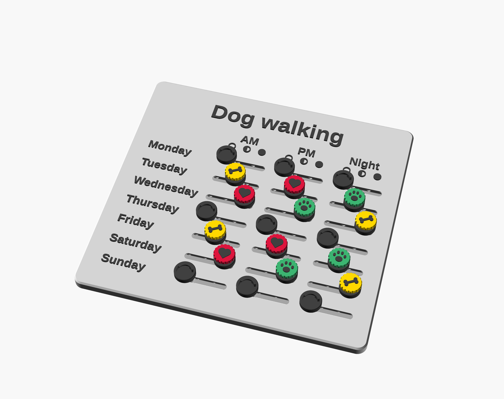

# 3d Chore Board (default: "Dog walking")

A wall or fridge chart for tracking a recurring chore. Each row is a day and each column a time slot. Every cell has a slider that clicks into one of several positions, and a swappable token on the knob shows who did it. The sliders print in place inside the board, so there's nothing to assemble.  The chore chart default is for dog walking where the sliders represent different walk durations and the tokens are for each family member, but you can change the labels, symbols and tokens to suit any set of chores.



## Files

```text
3d-chore-board/
├── README.md                 # Project overview and usage instructions
├── chore_board.scad          # Parametric 3D model and customization settings
├── build_stls.py             # Script for generating the STL files
├── render_previews.py        # Script for generating preview images
├── exports/
│   ├── board_twist.stl       # Board with twist-lock token mounts
│   ├── board_twist_stand.stl # Board with the stand
│   ├── slider_test_twist.stl # Test piece for the twist-lock slider
│   ├── token_bone_twist.stl  # Bone-shaped twist-lock token
│   ├── token_heart_twist.stl # Heart-shaped twist-lock token
│   ├── token_paw_twist.stl   # Paw-shaped twist-lock token
│   └── tray.stl              # Tray for holding tokens
├── renders/
│   ├── preview.png           # Rendered preview of the board
│   ├── board_twist.png
│   ├── slider_test_twist.png
│   ├── token_bone_twist.png
│   ├── token_heart_twist.png
│   ├── token_paw_twist.png
│   ├── tray.png
│   └── mounting/             # Previews of mounting options
│       ├── adhesive_strips.png
│       ├── bumper_pads.png
│       ├── cord_holes.png
│       ├── door_hooks.png
│       ├── door_hooks_side.png
│       ├── french_cleat.png
│       ├── keyholes.png
│       ├── magnets.png
│       └── stand.png
├── LICENSE                  # Project license
```

## How it works

**Board.** 178 × 165 mm and 7 mm thick, with a raised title, row and column labels, and a key under each column heading. With the default key (`empty, half, full`), the sliders read left to right as *not done*, *short walk* and *long walk*. Because "not done" is on the left, you can reset a whole column for the new week by running a ruler down it.

**Sliders.** Each slider is a carriage running in a channel inside the board. In cross-section the carriage is narrow at the bottom, wide in the middle and narrow at the top, so the board traps it from both the front and the back. A 3.4 × 10 mm neck rises through a slot to the knob. Two sprung arms, one on each side and pointing in opposite directions, have nubs that click into a notch at each stop. Every surface is either vertical or at 45°, so nothing needs supports, and there's a 0.3 mm gap between all moving and fixed parts.

**Knobs and tokens.** Each 13 mm knob has a recess for a token. By default tokens use a **twist lock**: drop the token in with its symbol on its side, then turn it a quarter turn clockwise until it stops. The symbol ends up upright and the token pulls snug. To remove it, turn it back and lift it out. Grip flutes around the edge make it easier to turn. Set `retention = "magnet"` to hold tokens with 4 × 1 mm magnets instead.

**Mounting.** All mounting options are settings in the *Mounting:* groups:

| Option | Setting | Notes |
|---|---|---|
| Fridge magnets | `board_magnets` (default) | Four 10 × 3 mm magnets in the rear corners. The pockets are shallower than the magnets, so the magnets stand 0.5 mm proud. That gives full pull and holds the sliders clear of the fridge. |
| Keyhole slots | `keyholes` | Two slots in the back of the title band, for hanging on screws. |
| Adhesive strips | `strips` | Corner pockets for removable picture-hanging strips. |
| French cleat | `cleat` | An angled groove in the back. A matching wall rail is added to the board STL. |
| Stand | `stand` | A desk or shelf stand, added to the board STL. |
| Door hooks | `hooks` | Two hanger arms, added to the board STL, that hook over a door (default 35 mm, typical for NZ interior doors, plus 2 mm so they slide on without flexing). The board sits on a ledge at the bottom of each arm, with a clip at the top. To fit it, lift the board up into the top clips, swing the bottom in, then lower it onto the ledges. |
| Cord holes | `cord_holes` | Two holes near the top corners for a ribbon or cord. |
| Bumper pads | `bumpers` | Pockets for felt or silicone pads, so only the pads touch the surface. Added automatically for keyholes and cord holes. |

Combinations that can't work, such as keyholes with a cleat, are stopped with an explanation.

## Customising

Open `chore_board.scad` in OpenSCAD and use **Window → Customizer**, or edit the values at the top of the file. Every setting has a one-line description.

- **Lists are comma separated:** `row_labels`, `col_labels`, `key_symbols`, `tokens` and `token_colours`. For example, `tokens = "A, B, star, blank"`.
- **The number of key symbols sets the number of click-stops.** Symbols can be `empty`, `half`, `full`, `cross`, `tick`, `none`, any token shape, or short text such as `1`.
- **Token shapes:** `star`, `heart`, `paw`, `bone`, `moon`, `triangle`, `diamond`, `bolt`, `blank`, or any short text such as initials.
- **Sizes adjust automatically:** columns widen and margins grow when needed. Settings that would break the print, such as walls that are too thin or too few key symbols, stop with a message saying what to change.
- **Preview only:** the preview colours (`knob_colour`, `token_colours`, and so on) only affect what you see in OpenSCAD.
- **Current settings:** set `part = "info"` to print a summary of the current settings.

```text
  [Title and labels]
    title = "Dog walking"
        Title text across the top of the board
    row_header = "Day"
        Heading above the row labels ("" for none)
    row_labels = "Monday, Tuesday, Wednesday, Thursday, Friday, Saturday, Sunday"
        Row labels, comma separated; the number of entries sets the number of rows
    col_labels = "AM, PM, Night"
        Slider column labels, comma separated; the number of entries sets the number of
        columns

  [Slider steps]
    key_symbols = "empty, half, full"
        Key symbols under each heading, comma separated, left to right. Each symbol is
        one click-stop, so the number of symbols sets the number of steps (2 or more).
        Putting "not done" first means a ruler slid down a column resets every slider at
        once. Use: empty, half, full, cross, tick, none, a token shape, or short text
    print_step = 0
        Step the sliders are printed in (0 = leftmost, normally the "not done" step)
    step_pitch = 10
        Distance between neighbouring stops (mm)

  [Text]
    font = "Liberation Sans:style=Bold"
        Font for all text (any installed font, e.g. "Liberation Sans:style=Bold")
    title_size = 11
        Title text height (mm)
    label_size = 5.5
        Row and column label text height (mm)
    key_size = 5
        Size of the key symbols under the headings (mm)
    relief = 0.8
        How far text and symbols stand out from the board face (mm)

  [Board layout]
    margin = 8
        Space around the edges of the board (mm)
    title_h = 22
        Height of the title band (mm)
    header_h = 18
        Height of the heading row: column labels + key (mm)
    row_h = 15
        Height of each row (mm)
    row_label_w = 48
        Width of the row-label column (mm)
    col_w = 38
        Width of each slider column; widened automatically if too small for the sliders
        (mm)
    corner_r = 6
        Radius of the board's rounded corners (mm)
    plate_t = 7
        Board thickness; houses the slider channels (mm)
    back_chamfer = 1.0
        45-degree chamfer on the rear edge of the board (mm)

  [Mounting: magnets]
    board_magnets = true
        Add magnet pockets in the four rear corners of the board
    board_mag_d = 10.2
        Board magnet pocket diameter: magnet + clearance (mm)
    board_mag_h = 2.5
        Board magnet pocket depth. Keep this LESS than the magnet thickness so the
        magnets stand about 0.5 mm proud of the back: they touch the fridge directly for
        full pull, and the board is held clear of the surface so the sliders don't drag
        on it (mm)
    board_mag_inset = 9
        Distance from the board edges to the pocket centres (mm)

  [Mounting: keyhole slots]
    keyholes = false
        Two keyhole slots in the back of the title band, to hang the board on screws
    keyhole_spacing = 100
        Distance between the two keyholes, centre to centre (mm)
    keyhole_head_d = 9
        Keyhole entry diameter: fits over the screw head (mm)
    keyhole_shank_d = 4.5
        Keyhole slot width: fits the screw shank (mm)
    keyhole_len = 10
        How far the slot runs up from the entry hole (mm)
    keyhole_depth = 4.5
        Total keyhole depth into the back of the board (mm)
    keyhole_lip = 2.0
        Thickness of the lip the screw head hooks behind (mm)

  [Mounting: adhesive strips]
    strips = false
        Shallow pockets in the four back corners for removable picture-hanging strips
    strip_l = 46
        Strip pocket length (mm)
    strip_w = 16
        Strip pocket width (mm)
    strip_depth = 0.8
        Strip pocket depth (mm)

  [Mounting: French cleat]
    cleat = false
        Angled groove across the back of the title band; the matching wall rail is added
        to the board STL
    cleat_len = 130
        Groove length (mm)
    cleat_w = 6
        Groove width at the back face (mm)
    cleat_depth = 4
        Groove depth into the board, at 45 degrees (mm)
    cleat_clr = 0.4
        Clearance between the groove and the wall rail (mm)
    cleat_rail_t = 4
        Wall rail backing plate thickness; also how far the board stands off the wall
        (mm)
    cleat_rail_h = 16
        Wall rail backing plate height below the lip, for the screws (mm)
    cleat_screw_d = 4.5
        Wall rail screw hole diameter (mm)

  [Mounting: cord holes]
    cord_holes = false
        Two holes near the top corners for a hanging cord or ribbon
    cord_hole_d = 4
        Cord hole diameter (mm)
    cord_hole_inset_x = 18
        Distance from the side edges to the holes (mm)
    cord_hole_inset_y = 10
        Distance from the top edge to the holes (mm)

  [Mounting: stand]
    stand = false
        Add a desk/shelf stand (printed beside the board in the board STL) that the
        board slots into
    stand_len = 100
        Stand length (mm)
    stand_depth = 55
        Stand base depth, front to back (mm)
    stand_angle = 15
        How far the board leans back from vertical (degrees)
    stand_slot_depth = 8
        Height of the front lip in front of the board; keep below the lowest knob (mm)
    stand_back_h = 18
        Height of the back support behind the board (mm)
    stand_slot_clr = 0.5
        Clearance in the slot around the board thickness (mm)
    stand_round = 1.5
        Rounding on every outside edge of the stand (mm)
    stand_fillet = 5
        Fillet where the cradle blends into the base (mm)
    stand_pads = true
        Pockets underneath for bumper pads (bumper_d x bumper_h) so the stand doesn't
        scratch furniture

  [Mounting: door hooks]
    hooks = false
        Add two over-door hanger arms (printed beside the board in the board STL). Each
        hooks over the top of a door, runs down behind the board and catches its bottom
        edge on a ledge; a clip at the top stops it tipping forward. Fit the board by
        lifting it up into the top clips, swinging the bottom in, then lowering it onto
        the ledges.
    hook_door_t = 35
        Door thickness; NZ interior doors are typically 35 mm (mm)
    hook_tol = 2
        Extra room in the hook so it slides over the door without flexing (mm)
    hook_drop = 20
        Gap between the top of the door and the top of the board (mm)
    hook_top_t = 2.5
        Thickness of the bridge over the top of the door; must fit the gap between door
        and frame (mm)
    hook_wall = 4
        Thickness of the arm, ledge and lips; thicker is stronger (mm)
    hook_tail = 25
        How far the hook's tail reaches down the back of the door (mm)
    hook_width = 20
        Width of each arm (mm)
    hook_lip = 6
        Height of the lips in front of the board at the top and bottom (mm)
    hook_clr = 0.5
        Clearance around the board thickness in the ledge and top clip (mm)
    hook_standoff = 1.5
        Ribs on the arm hold the board this far off it, so the sliders don't drag (mm)
    hook_chamfer = 0.8
        45-degree chamfer on the arm edges (mm)

  [Mounting: bumper pads]
    bumpers = "auto"   choices: auto, on, off
        Pockets in the back for self-adhesive felt or silicone bumper pads. They stand
        proud so only the pads touch the wall or door: the sliders run in clear air and
        nothing hard rubs or marks the surface. "auto" adds them for keyholes or cord
        holes when nothing else holds the board off the surface (magnets, strips and the
        cleat already do).
    bumper_d = 8
        Bumper pad diameter (mm)
    bumper_h = 2
        Bumper pad thickness (mm)
    bumper_proud = 1
        How far each pad stands proud of the back; the pocket depth is bumper_h minus
        this (mm)
    bumper_clr = 0.2
        Clearance around each pad in its pocket (mm)
    bumper_inset = 9
        Distance from the board edges to the corner pads (mm)

  [Slider (print-in-place)]
    clr = 0.3
        Gap between the moving slider and the board; raise if stuck, lower if loose (mm)
    car_len = 10
        Length of the sliding carriage (mm)
    car_b = 3
        Carriage width where it sits on the print bed; narrower = less contact with the
        surface behind (mm)
    car_w = 7
        Carriage width at its widest point (mm)
    car_z1 = 2.0
        Height where the carriage stops widening; at least (car_w - car_b)/2 to keep the
        flare at 45 degrees (mm)
    car_z2 = 3.8
        Height where the carriage starts narrowing toward the neck; at least car_z1 +
        2*nub (mm)
    car_end_chamfer = 0.6
        45-degree chamfer on the bottom edges at each end of the carriage, so nothing
        sharp touches the surface (mm)
    neck_w = 3.4
        Width of the neck that passes through the slot (mm)
    neck_len = 10
        Length of the neck along the slot; longer = stronger, up to car_len (mm)
    arm_t = 1.2
        Thickness of the click-stop spring arms; thicker = stiffer (mm)
    arm_slit = 0.7
        Gap behind each spring arm; must be larger than nub - clr (mm)
    arm_root = -4
        Where the spring arms join the carriage, from its centre (mm)
    nub = 0.9
        How far the click-stop nubs stick out; larger = firmer click (mm)
    nub_r = 1.2
        Radius of the click-stop nubs (mm)
    nub_x = 3.6
        Position of the nubs along the carriage (mm)
    foot_relief = 0.2
        Extra gap at the carriage's first layer, against elephant's foot (mm)

  [Knob]
    knob_d = 13
        Knob diameter; must leave at least min_wall around the token recess (mm)
    line_w = 0.42
        Your printer's extrusion line width; sets the minimum wall around the token
        recess (mm)
    knob_gap = 0.3
        Gap between the knob underside and the board face (mm)
    knob_top_h = 3.4
        Height of the straight part of the knob above its 45-degree underside (mm)

  [Tokens]
    tokens = "paw, bone, heart"
        Tokens, comma separated, one STL each: star, heart, paw, bone, moon, triangle,
        diamond, bolt, blank, empty, half, full, cross, tick, or text
    retention = "twist"   choices: twist, magnet
        How tokens are held in the knobs (applies to the board and token STLs)
    test_retention = "twist"   choices: twist, magnet, same
        Token holding method for the slider test ("same" follows retention)
    token_face_d = 13
        Token face diameter; overhangs the knob for grip (mm)
    face_flat = 1.6
        Height of the straight edge of the token face; taller gives more to grip (mm)
    grip_count = 18
        Number of grip flutes around the token edge (0 = smooth)
    grip_depth = 0.6
        Depth of each grip flute (mm)
    grip_w = 1.2
        Width of each grip flute (mm)
    symbol_h = 0.6
        How far the token symbol stands out (mm)
    symbol_size = 8.5
        Size of the symbol on the token face (mm)
    fit = 0.15
        Radial clearance of the token plug in the knob; raise if tight (mm)

  [Token magnets (retention = magnet)]
    m_recess_d = 9.4
        Diameter of the token recess in the knob top (mm)
    m_recess_h = 2.0
        Depth of the token recess in the knob top (mm)
    tmag_d = 4.2
        Token/knob magnet pocket diameter: magnet + clearance (mm)
    tmag_h = 1.1
        Token/knob magnet pocket depth: magnet + clearance (mm)

  [Token twist lock (retention = twist)]
    tw_mouth_d = 8.0
        Diameter of the knob opening the token plug fits through (mm)
    tw_lug_d = 9.2
        Diameter across the token's two locking lugs (mm)
    tw_channel_d = 10.2
        Diameter of the channel the lugs turn in (mm)
    tw_lug_h = 1.4
        Thickness of the locking lugs (mm)
    tw_lip = 1.2
        Thickness of the knob lip the lugs lock under (mm)
    tw_lug_deg = 36
        Angular width of each lug (degrees)
    tw_slot_deg = 46
        Angular width of the entry slots in the knob (degrees)
    tw_loose = 0.4
        Clearance at the start of the turn (mm)
    tw_squeeze = 0.0
        Grip at the end of the turn; 0 = just touching, raise if tokens work loose,
        negative for more play (mm)
    tw_lock_dir = -1
        Locking direction: -1 = clockwise, 1 = anticlockwise
    tw_floor_gap = 0.3
        Clearance under the lugs (mm)
    tw_turn_clr = 5
        Extra turn allowed past the locked position before the hard stop (degrees)

  [Token tray]
    tray_w = 55
        Tray outside width (mm)
    tray_d = 34
        Tray outside depth, back to front (mm)
    tray_back_h = 36
        Tray height at the back (mm)
    tray_front_h = 30
        Tray height at the front (mm)
    tray_wall_t = 2.4
        Side and front wall thickness (mm)
    tray_floor_t = 2.4
        Floor thickness (mm)
    tray_back_t = 5
        Back wall thickness; must fit the magnet pockets (mm)
    tray_scoop_r = 14
        Radius of the curved scoop inside the front (mm)
    tray_chamfer = 1.0
        45-degree chamfer on the bottom outside edge (mm)
    tray_outer_r = 5
        Radius of the outside vertical corners (mm)
    tray_inner_r = 3
        Radius of the inside corners and floor edges (mm)
    tray_top_r = 1.2
        Rounding on the tops of the walls (mm)
    tray_compartments = 1
        Number of compartments (1 = no dividers)
    tray_divider_t = 1.6
        Divider thickness (mm)

  [Tray magnets]
    tray_mag_d = 10.2
        Tray magnet pocket diameter: magnet + clearance (mm)
    tray_mag_h = 3.2
        Tray magnet pocket depth: magnet + clearance (mm)
    tray_mag_cols = 2
        Number of magnet pockets across the back
    tray_mag_rows = 2
        Number of magnet pockets up the back
    tray_mag_inset_x = 14
        Distance from the tray sides to the outer pockets (mm)
    tray_mag_low_z = 10
        Height of the lower row of pockets (mm)
    tray_mag_high_z = 26
        Height of the upper row of pockets (mm)
```

## Building the STLs

### From OpenSCAD
Open `chore_board.scad` in OpenSCAD, set the part in the **Customizer**, options for printing are, board, slider_test, token, tray.  Then render and export the STL.  For the tokens you'll need to step through each token shape in the Customizer and export each one by incrementing the token_index value.

### Using the python script

```
  python3 build_stls.py                                                                # build everything
  python3 build_stls.py tokens                                                         # just the tokens
  python3 build_stls.py --set retention=magnet                                         # magnet board + tokens              
  python3 build_stls.py tokens --set 'tokens=A, B, C, blank'                           # one of each of the tokens
  python3 build_stls.py --set 'title=Feed the cat' \
      --set 'key_symbols=empty, full' --set print_step=0 \
      --set 'row_labels=Mon, Tue, Wed, Thu, Fri' --set 'col_labels=Breakfast, Dinner'  # change the title, key and labels
  python3 build_stls.py --set keyholes=true --set board_magnets=false                  # board with keyholes, no magnets
  python3 build_stls.py --set stand=true                                               # board STL includes the stand
  python3 build_stls.py --set hooks=true --set hook_door_t=35                          # adds over-door hanger arms
  python3 build_stls.py --options tray                                                 # options for one STL
```

The script needs OpenSCAD installed. If it isn't on your PATH, set the `OPENSCAD` environment variable to its location. The board takes a few minutes to render, and the other parts take seconds.

## Printing advice

**Print the slider test first.** Print-in-place parts depend on your printer's accuracy. Ten minutes on the test coupon will tell you whether the full board will work. Free the slider (see below), then check that it clicks into every stop, the knob feels sturdy, and the token twists on and off.

**Material.** PETG is the best choice for the board: the spring arms flex without cracking, and the neck is tougher. PLA works if you prefer it. Tokens and the tray can be any material.

**Slicer settings:**
- **No supports, anywhere.** Turn supports off and check the preview. Supports generated inside the slider channels will weld the sliders solid.
- **Elephant-foot compensation of about 0.15 mm.** The slider undersides print right next to the board on the first layer, which is where parts most often fuse.
- **0.2 mm layers.** The slider's key heights are multiples of 0.2 mm.
- **Line width:** the model assumes 0.42 mm (`line_w`) for its minimum wall checks.
- **Walls and infill:** 3–4 walls and 15–20% infill. Optionally, use a modifier to print the sliders solid for an even stronger neck.
- **Build plate:** a smooth plate gives the slider undersides a glossy finish that's kinder to whatever surface they sit against.

**Orientation.** Every STL is exported in its print orientation, so don't rotate anything. The board prints face-up, tokens plug-down, the tray upright, the stand base-down, the cleat rail with its backing plate down, and the door-hook arms lying on their sides, which is their strong direction.

**Tokens** Clone each of the token STLs in your slicer for as many as you need.

**Bed size.** When any of the cleat rail, stand or door hooks are switched on, they're laid out beside the board in the same STL. The door-hook arms are about 190 mm long. On a smaller bed, split the parts into separate plates using the cut tool in your slicer, and consider printing the arms diagonally.

**Door hooks.** Print the arms in PETG if you can. The bridge over the top of the door is only 2.5 mm thick (`hook_top_t`) so the door still closes. Check the gap between your door and its frame, and raise `hook_top_t` if there's room, which makes the bridge stronger.

**Two-colour text (optional).** Add a filament change at **7.0 mm** to print the text and key in a second colour. The knobs rise above that height too, so they'll print in the second colour as well, which looks neat. I like to use the color painting tool and set a height range of 5mm to colour the text on the board and the neck of the slider knobs.

**After printing:**
1. **Free the sliders.** Push each knob firmly left and right, then work it through every stop a few times. A little resistance on the first move is normal.
2. **Fit the magnets.** Glue the corner magnets in with a drop of superglue or epoxy. Polarity doesn't matter for sticking to steel. For magnet tokens, put every knob magnet in the same way up and every token magnet the opposite way.
3. **Fit bumper pads,** if you're using them. Stick or glue them into their pockets.

## Troubleshooting and tuning

| Problem | Setting to change |
|---|---|
| Slider fused or stiff | Raise `clr` (try 0.35–0.4), and check elephant-foot compensation |
| Slider loose or rattly | Lower `clr` (try 0.25) |
| Click too weak | Raise `nub` slightly, or `arm_t` to 1.4 |
| Click too stiff | Lower `nub` slightly |
| Twist token too tight | Set `tw_squeeze` negative (for example −0.1) |
| Twist token works loose | Raise `tw_squeeze` (0.05–0.1) |
| Token plug tight in the recess | Raise `fit` |
| Board needs to sit further off the surface | Turn on `bumpers`, or lower `board_mag_h` so the magnets stand further proud |
| Door hook too tight or too loose on the door | Set `hook_door_t` to your door's thickness; `hook_tol` adds the extra room |
| Door won't close with the hooks on | Lower `hook_top_t` to fit the gap between the door and frame |
